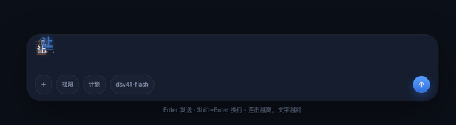

# dsh-power-type

English | [中文](README.zh.md)

Power Mode typing effects for the **DeepSeek Harness (DSH) Web composer**.



## Features

- Caret particles and glowing character echoes.
- Editor shake and combo streaks.
- Chinese and other IME composition support.
- Enter-triggered bursts and shockwaves.

## Installation

Requires DSH Web `>=0.2.1-rc.2 <0.3.0`. Install directly from GitHub:

```sh
dsh plugin --profile web add github:huangzhilin-hzl/dsh-power-type
```

If running DSH from source, execute this from the **DSH repository root**:

```sh
pnpm dsh plugin --profile web add github:huangzhilin-hzl/dsh-power-type
```

Restart DSH Web and refresh the page after installation. No plugin build is required.

For local development, install from a local checkout instead:

```sh
dsh plugin --profile web add /absolute/path/to/dsh-power-type
```

Local installation uses a directory link, so keep that directory in place.

## Usage

Start typing in the composer. Effects are enabled by default. Toggle the plugin under **Plugins → Installed plugins → Power Type**.

Adjust intensity in the browser console:

```js
window.__dshPowerType.setIntensity(1.5) // Default: 1; range: 0.2–2.5
```

The intensity setting is saved locally in the browser.

## Uninstall

```sh
dsh plugin --profile web remove dsh-power-type
```

For a DSH source checkout, use `pnpm dsh` instead of `dsh`.

## Development

Install dependencies in a DSH checkout, then run these commands from this plugin directory:

```sh
export DSH_CHECKOUT=/absolute/path/to/deepseek-harness
node --test test/engine.test.mjs
node --test test/browser.test.mjs
node --test test/dsh.test.mjs
```

Browser tests require Chrome/Chromium. DSH integration also requires `pnpm` and a built Web frontend at `apps/web/dist` in the DSH checkout. Use `CHROME_PATH` and `DSH_TEST_PNPM` to specify executable paths when needed.

Set `DSH_PLUGIN_SPEC=github:huangzhilin-hzl/dsh-power-type` to run the DSH integration test against the remote package.

Open [demo/index.html](demo/index.html) for a standalone visual demo.
